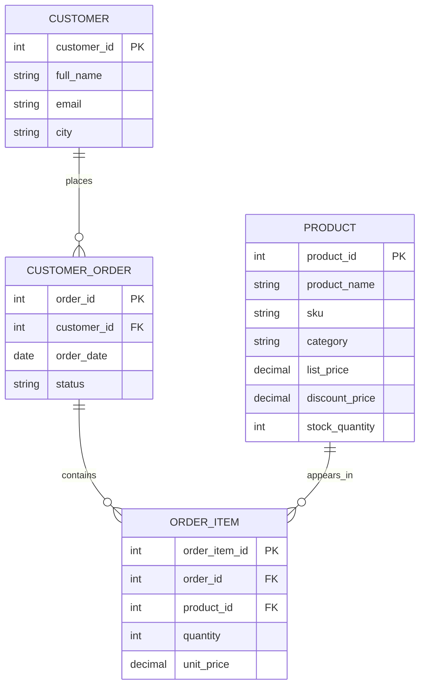

# Online alışveriş sistemi — ER diyagramı

Bir müşteri birden fazla sipariş verebilir; bir sipariş tek müşteriye aittir. Sipariş ve ürün arasındaki M:N ilişki `order_item` ile iki adet 1:N ilişkiye ayrılır.
